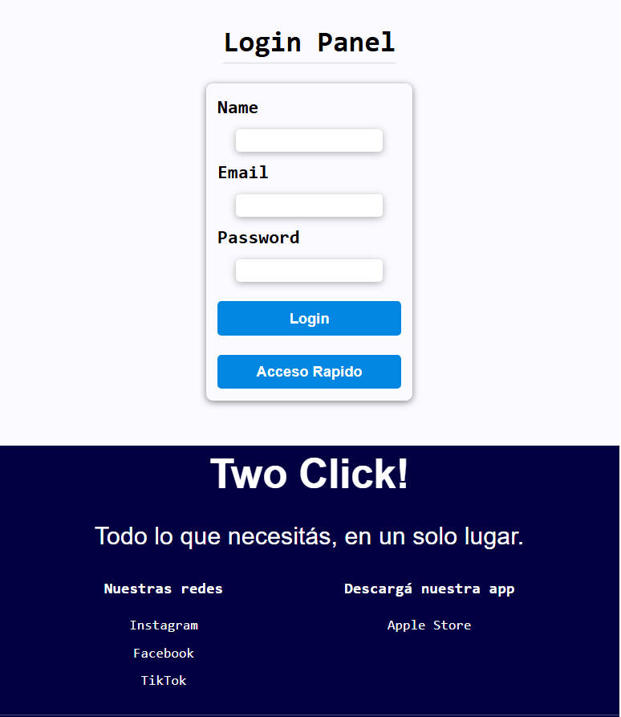
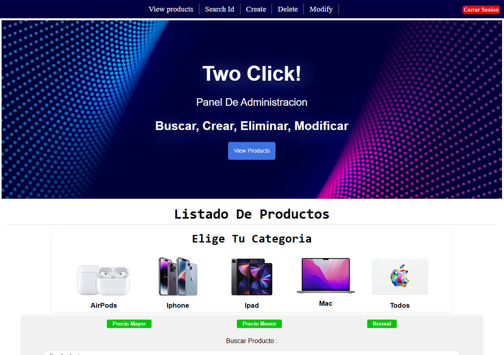
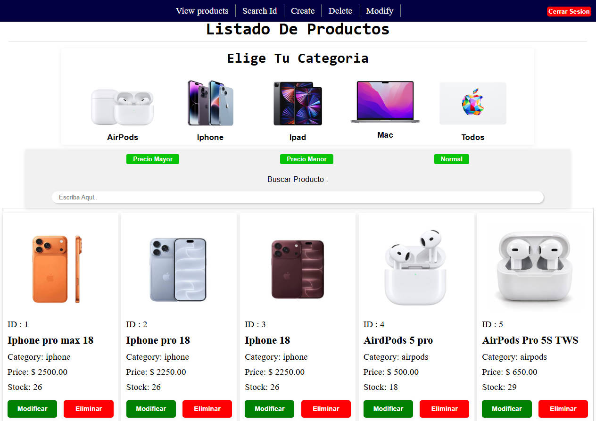
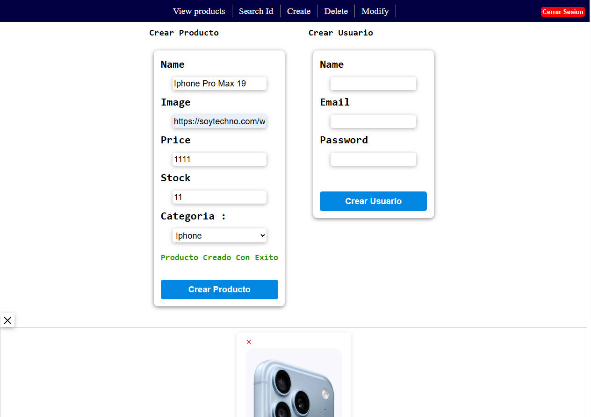
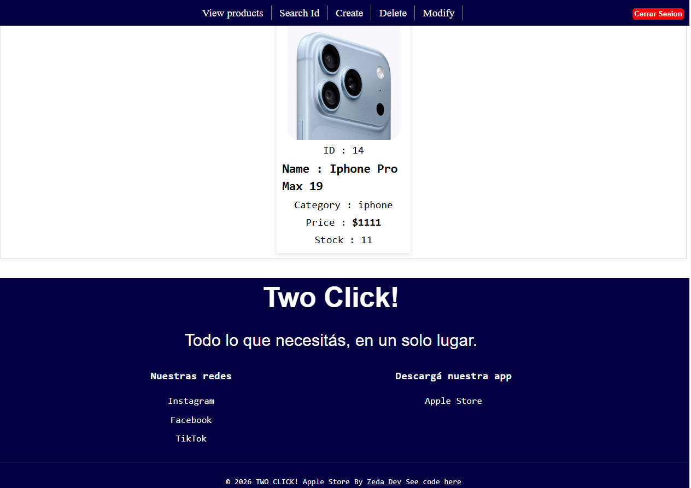
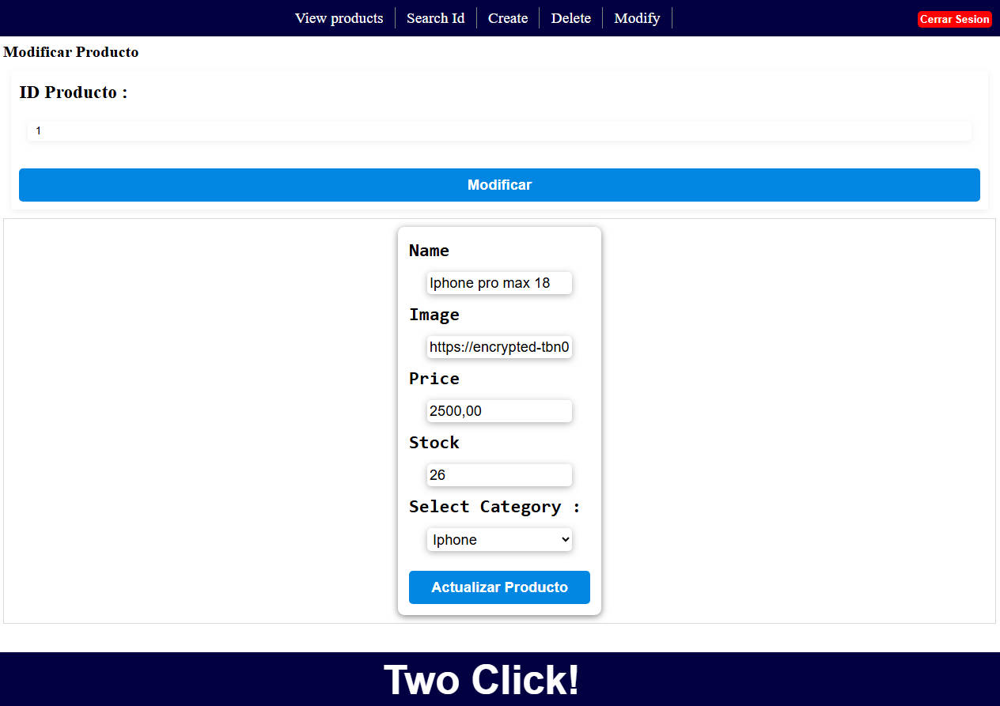
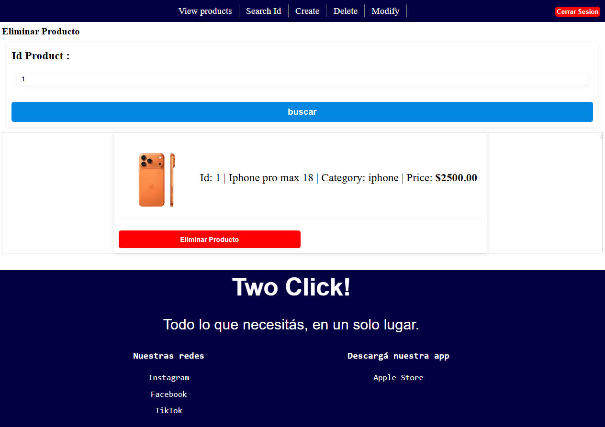

# API REST - Gestión de Productos y Ventas

API REST desarrollada con **Node.js**, **Express** y **MySQL**, orientada a la gestión de productos, administración de usuarios y, registro de ventas asociando productos.

El proyecto también cuenta con un panel administrativo desarrollado con EJS, que permite gestionar los productos mediante una interfaz web.
---

## Tecnologías utilizadas

| Tecnología | Descripción |
|---|---|
| [Node.js](https://nodejs.org/) | Entorno de ejecución de JavaScript del lado del servidor. |
| [Express](https://expressjs.com/) | Framework web para la creación y gestión de rutas, middlewares y endpoints REST. |
| [MySQL](https://www.mysql.com/) | Sistema de gestión de bases de datos relacional. |
| [EJS](https://ejs.co/) | Motor de plantillas para generar vistas HTML dinámicas desde el servidor. |
| [bcrypt](https://www.npmjs.com/package/bcrypt) | Biblioteca para generar y verificar hashes de contraseñas. |
| [express-session](https://www.npmjs.com/package/express-session) | Middleware para la administración de sesiones de usuario. |
| [dotenv](https://www.npmjs.com/package/dotenv) | Gestión de variables de entorno y configuración de la aplicación. |

---

## Características

- **Gestión de productos:** Operaciones CRUD para crear, consultar, modificar y eliminar productos.
- **Consultas por identificador:** Búsqueda de productos mediante su ID.
- **Administración de usuarios:** Registro de usuarios administradores.
- **Gestión de ventas:** Registro de ventas asociadas a productos.
- **Panel administrativo:** Interfaz web dinámica desarrollada con EJS.
- **Autenticación:** Validación de credenciales mediante bcrypt.
- **Gestión de sesiones:** Administración de sesiones mediante express-session para controlar el acceso al panel administrativo.
- **Conexión a MySQL:** Administración de conexiones mediante un pool de conexiones.
- **Arquitectura MVC:** Separación de responsabilidades mediante rutas, controladores, modelos y middlewares.

---

# Instalación y configuración

## 1. Clonar el repositorio

```bash
git clone https://github.com/a11vazquez/admin-backend
```

## 2. Navegar al directorio del proyecto

```bash
cd admin-backend
```
## 3. Instalar dependencias

```bash
npm install
```

## 4. Configurar las variables de entorno
- Crear un archivo .env en el directorio raiz del proyecto
- Definir las variables necesarias para la configuracion de la aplicacion y la conexion a MySQL:


```env
# Server
PORT=3000

# Database
DB_HOST=localhost
DB_USER=root
DB_PASSWORD=
DB_NAME=nombre_base_datos
DB_PORT=3306

# Session
SESSION_SECRET=tu_clave_secreta
```

## 5. Configurar la base de datos
- Crear la base de datos en MySQL utilizando el siguiente comando:


```sql
CREATE DATABASE nombre_base_datos;
```
## Ejecutar aplicacion 
- Modo desarrollo :


```bash
npm run dev
```

- Modo Produccion :

```bash
npm start
```

---


# API ENDPOINTS


## Products


### GET `/api/products`

obtiene todos los productos registrados en la BDD

***Request:***

```http
GET /api/products
```

**Respuesta: `200 Ok`**
```json
[
    {
        "id": 1,
        "name": "Iphone pro max 18",
        "img": "https://google.com/apple/image/iphonepro18",
        "category": "iphone",
        "price": "1200",
        "stock": "11"
    },
      {
        "id": 2,
        "name": "Iphone max pro 18",
        "img": "https://google.com/apple/image/iphonemaxpro18",
        "category": "iphone",
        "price": "1300",
        "stock": "11"
    }
]
```

***Posibles respuestas:***
| Status | Respuesta |
| --- | --- |
| 200 | Respuesta Exitosa. |
| 500 | Error Interno del servidor |
---

### GET `/api/products/:id`

obtiene un producto por su id

***Request:***

```http
GET /api/products/1
```

**Respuesta: `200 Ok`**
```json
    {
        "id": 1,
        "name": "Iphone pro max 18",
        "img": "https://google.com/apple/image/iphonepro18",
        "category": "iphone",
        "price": "1200",
        "stock": "11"
    }
```

***Posibles respuestas:***
| Status | Respuesta |
| --- | --- |
| 200 | Respuesta Exitosa. |
| 404 | Not Found |
| 500 | Error Interno del servidor |

---

### POST `/api/products`

crea un producto en la BDD

***Request:***

```http
POST /api/products
Content-Type: application/json
```
***Request Body:***

```json
   {
        "id": 1,
        "name": "Iphone pro max 18",
        "img": "https://google.com/apple/image/iphonepro18",
        "category": "iphone",
        "price": "1200",
        "stock": "11"
    }
```

**Respuesta: `201 Created`**
```json
[
    {
        "id": 1
    }
]
```

***Posibles respuestas:***
| Status | Respuesta |
| --- | --- |
| 201 | Producto Creado Con Exito |
| 400 | Datos Incompletos |
| 409 | Producto Existente |
| 500 | Error Interno del servidor |


---

### DELETE `/api/products/:id`

elimina un producto por su id

***Request:***

```http
DELETE /api/products/1
```

**Respuesta: `200 Ok`**
```json
    {
        "result": true
    }
```

***Posibles respuestas:***
| Status | Respuesta |
| --- | --- |
| 200 | Producto Eliminado Con Exito |
| 404 | No Existe El Producto |
| 500 | Error Interno del servidor |


---
---

### PUT `/api/products/:id`

modifica un producto por su id

***Request body:***
```json
{
    "name": "Iphone pro max 18",
    "img": "https://google.com/apple/image/iphonepro18",
    "category": "iphone",
    "price": 1400,
    "stock": 14
}

```

***Request:***

```http
PUT /api/products/1
Content-Type: application/json
```

**Respuesta: `200 Ok`**
```json
{
    "message": "Producto modificado correctamente"
}
```

***Posibles respuestas:***
| Status | Respuesta |
| --- | --- |
| 200 | Producto Modificado Con Exito |
| 404 | No Existe El Producto |
| 500 | Error Interno del servidor |


---


# EJS VIEWS - Panel Administrativo

### GET `/login`

Renderiza la vista de inicio de sesión del administrador.

**View:** `login.ejs`

**Layout:** `layout/auth.ejs`

**Render Inputs:**

| Name | Type | Description |
|---|---|---|
| title | String | Título de la página. |
| layout | String | Layout del login utilizado para renderizar la vista. |

**Render example:**

```javascript
res.render("login", {
    title: "Login Panel",
    layout: "layout/auth"
});
```

---

### POST `/login`

Procesa el inicio de sesión del administrador mediante la validación de session. Verifica que el usuario exista en la base de datos y compara la contraseña utilizando bcrypt. Si las credenciales son correctas, inicia una sesión y redirecciona al panel.

**Method:** `POST`

**Request Body:**

| Name | Type | Description |
|---|---|---|
| name | String | Nombre del administrador. |
| email | String | Correo electrónico del administrador. |
| password | String | Contraseña del administrador. |

**Responses:**

| Status | Description |
|---|---|
| 302 | Redirecciona al panel si las credenciales son correctas. |
| 500 | Error interno del servidor. |

**Possible error messages:**

| Error | Description |
|---|---|
| Todos los campos son necesarios | Alguno de los campos está vacío. |
| Usuario Admin No Encontrado | No existe un administrador con ese email. |
| contraseña incorrecta | La contraseña ingresada no coincide. |

**Successful authentication:**

```javascript
req.session.user = {
    id: user.id,
    userName: user.name,
    email: user.email
};

res.redirect("/panel");
```

---

### POST `/logout`

Destruye la session y, redirecciona al login

**Method:** `POST /logout`

**Responses:**

| Status | Description |
|---|---|
| 500 | Error interno del servidor. |


**res example:**

```javascript
res.redirect("/login");
```

---
### GET `/panel`

Renderiza el panel principal con el listado de productos registrados en la base de datos.

**View:** `index.ejs`

**Render Inputs:**

| Name | Type | Description |
|---|---|---|
| title | String | Título de la página. |
| about | String | Descripción o encabezado de la sección. |
| products | Array | objetos obtenidos de la base de datos. |

**Render example:**

```javascript
res.render("index", {
    title: "Panel",
    about: "Listado De Productos",
    products: rows
});
```

---
---
### GET `/search`

Renderiza la vista para buscar productos 

**View:** `search.ejs`

**Render Inputs:**

| Name | Type | Description |
|---|---|---|
| title | String | Título de la página. |
| about | String | Descripción o encabezado de la sección. |

**Render example:**

```javascript
 res.render("search", {
                title: "Buscar Por ID"
        });
```

---
---
### GET `/create`

Renderiza la vista para crear un producto 

**View:** `create.ejs`

**Render Inputs:**

| Name | Type | Description |
|---|---|---|
| title | String | Título de la página. |
| about | String | Descripción o encabezado de la sección. |


**Render example:**

```javascript
  res.render("create", {
                title: "Crear Producto",
                about: "Producto",
        });
```

---
---
### GET `/modify`

Renderiza la vista para modificar un producto 

**View:** `modify.ejs`

**Render Inputs:**

| Name | Type | Description |
|---|---|---|
| title | String | Título de la página. |
| product | null | se pasa el array en /modify:id en /modify null |


**Render example:**

```javascript
      res.render("modify", {
                title: "Modificar Producto",
                product: null
        });
```

---

---
### GET `/modify/:id`

Renderiza la vista y, el producto a modificar segun id

**View:** `modify.ejs`

**Render Inputs:**

| Name | Type | Description |
|---|---|---|
| title | String | Título de la página. |
| product | Object | objeto producto del id |


**Render example:**

```javascript
       res.render("modify", {
                        title: "Modificar Producto",
                        product: product
                });
```

---
---
### GET `/DELETE`

Renderiza la vista para eliminar un producto 

**View:** `delete.ejs`

**Render Inputs:**

| Name | Type | Description |
|---|---|---|
| title | String | Título de la página. |
| product | null | se pasa el array en /delete:id en /delete null |


**Render example:**

```javascript
     res.render("delete", {
                title: "Eliminar Producto",
                product: null
        });
```

---

---
### POST `/delete/:id`

Renderiza la vista y, el producto a eliminar segun id

**Render Inputs:**

| Name | Type | Description |
|---|---|---|
| title | String | Título de la página. |
| product | Object | objeto producto del id |


**Render example:**

```javascript
        res.render("delete", {
                        title: "Eliminar Producto",
                        product: product
                });
```

---

#  User - Administracion de usuarios

### POST `api/users`

Crea un usuario en la BDD

***Request:***

```http
POST /api/users
```

***Request Body:***

```json
   {
        "user": "admin",
        "email": "admin@admin.com",
        "password": "adminpw",
    }
```

**Respuesta: `201 Created`**
```json
    {
      message: "usuario creado con exito",
      userID: rows.insertId
    }
```

***Posibles respuestas:***
| Status | Respuesta |
| --- | --- |
| 201 | Usuario creado con exito |
| 400 | Datos incompletos |
| 409 | Email ya existente |
| 500 | Error interno |

---


# Sales - Registro de ventas

### POST /api/sales

Registra una venta en la BDD asociando los id de cada producto

***Request:***

```http
POST /api/sales
Content-Type: application/json
```


***Request Body:***

```json
   {
        "totalPrice": "1111",
        "name": "usuario",
        "email": "usuario@user.com",
        "phone": "1140415058",
        "idProducts": [1,2,3,4,5]
    }
```

**Respuesta: `201 Created`**
```json
    {
      message: "Venta registrada con exito",
    }
```

***Posibles respuestas:***
| Status | Respuesta |
| --- | --- |
| 201 | Venta registrada con exito |
| 500 | Error interno |

---

# Screenshots

Capturas de pantalla del panel administrativo desarrollado con EJS.

## Login



## Panel



## Gestión de productos



## Crear producto





## Modificar producto



## Eliminar producto



---

## Project Structure
La aplicación utiliza una arquitectura ***MVC*** Modelo-Vista-Controlador, separando las responsabilidades de cada componente para facilitar el mantenimiento y la escalabilidad del proyecto.

```
admin-backend/ -> Es la raiz de nuestro proyecto
|
├── docs/
|   ├── screenshots -> imagenes de muestra del proyecto
|   
├── src/ -> Source: Contiene la logica principal de la aplicacion
│   ├── api/ -> Logica de nuestra API REST
|   |   ├── config/ -> Archivo para obtener y exportar la info de las variables de entorno .env
|   |   ├── controllers/ -> Logica para gestionar peticiones y respuestas, req y res
|   |   ├── database/ -> Crea el pool de conexiones a la BBDD MySQL
|   |   ├── middlewares/ -> Funciones que se ejecutan entre la req y la res
|   |   ├── models/ -> Comunicaciones con la BBDD
|   |   ├── routes/ -> Desacoplamos las rutas que originalmente iban en el index.js, llaman al controlador
|   |   ├── utils/ -> Logica para trabajar con archivos y rutas de proyecto
|   |   |
│   ├── public/ -> Archivos estaticos (img, css, js)
│   └── views/ -> Vistas EJS que sirve el back
|
├── .env -> Las variables que contienen info sensible, constraseñas, puertos, etc
├── server.js -> Archivo de arranque del servidor, que centraliza toda la logica de la aplicacion
├── package.json -> "Libro" de instrucciones que centraliza la info que necesita nuestra app para funcionar
├── README.md -> Documentacion 
```
